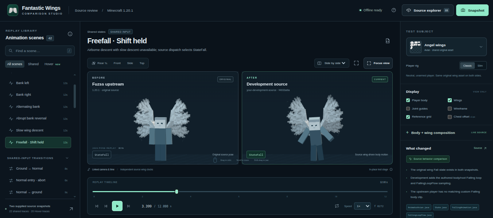

# Fantastic Wings — Unofficial Development Fork

> [!WARNING]
> This is an experimental development project, not an official release. Publishing configuration still contains inherited upstream project identifiers. Do not run publishing tasks or distribute builds until the metadata and third-party licensing have been reviewed.

An unofficial, work-in-progress modification by **[MrMR711](https://github.com/MrMR-711)** of [Fantastic Wings by Fuzss](https://github.com/Fuzss/fantasticwings), itself a continuation of **Wings by Pau101**. The display name MrMR711 is used here; the GitHub account is `MrMR-711`.


## Overview

This project adds a separate **Hover Flight** mode and adjusts player animations and transitions so hovering, normal wing flight, takeoff, falling and landing feel more connected. The added animations aim to improve the overall flight experience and make flying feel more natural and immersive. The original wings and normal-flight gameplay remain the foundation.

## Features

- **Hover Flight:** toggle with **V** by default, move horizontally, ascend with Space and descend with Shift. Forward Sprint uses a faster flight pose without automatically changing altitude.
- **Flight animation:** custom takeoff, landing, Falling and Normal Flight player animations, with transitions between states and coordinated wing and body movement.
- **Avian wings:** adjusted Lift and Glide cycles, wing/feather motion and a visual wing-braking response when reversing direction in Hover.
- **Landing visuals:** speed-dependent visual effects and an Enhanced Flight–adapted superhero landing pose, without added area damage or knockback.
- **First- and third-person presentation:** Hover arm and hand poses and transitions, subject to item and rendering limitations.

Hover is implemented as a separate Fantastic Wings flight mode, not actual Creative flight. For detailed behavior, transition notes and limitations, see [Animation details](docs/animation-details.md).

## Animation comparison studio

Explore the experimental [animation comparison studio](https://mrmr-711.github.io/fantastic-wings-dev/), created with help from an AI animation agent to compare this development source with Fuzss's original.

[](https://mrmr-711.github.io/fantastic-wings-dev/)

*Click the image to open the studio.*

## Known issues

The following section documents known limitations and potential synchronization issues that require further testing.

- **Hover braking is local-only:** the Avian braking cue responds to the local player's input and can appear on their own client, including when connected to a server. Other clients do not currently receive or reconstruct that cue. The local result received positive user feedback; multiplayer behavior still needs testing.
- **Normal Flight turning:** rapidly reversing left/right turns can cause a visible body or camera jerk. The behavior was also observed with Fuzss's 1.20.1 turning behavior; the original Wings source by Pau101 has not been tested. The underlying cause remains unconfirmed and the issue has not been fixed. See [Technical notes](docs/technical-notes.md) for the investigation and qualifications.
- **Potential multiplayer differences:** Hover Sprint detection, randomized idle-leg variation and landing effect/animation timing may differ between viewers or be delayed. These are code-based concerns, not confirmed multiplayer failures. Hover and Normal Flight mode state themselves are synchronized.
- Armor, capes, items, first-person rendering, other animation mods, rapid state changes and multiplayer require further testing.

## Compatibility

| Environment | Status |
| --- | --- |
| Minecraft Java 1.20.1 | Development target |
| NeoForge 47.1.106 | User's development and testing environment; earlier successful build predates some later changes |
| Fabric | Module exists; testing and compatibility of these changes are unconfirmed |
| Other Minecraft versions | Not declared or tested |

The presence of Common, Fabric and Forge modules does not establish tested support for all loaders or versions. The latest source snapshot has not been verified by a fresh build.

## Credits and licensing

- **Fantastic Wings:** original project by [Fuzss](https://github.com/Fuzss/fantasticwings), continuing Wings by Pau101. The upstream source and asset license files are retained.
- **Enhanced Flight:** Hover idle, superhero landing and additional pose/renderer and landing visual logic are adapted from [Enhanced Flight by CheatyBlack](https://www.curseforge.com/minecraft/mc-mods/enhanced-flight), version **1.0.6**; see `THIRD-PARTY-ENHANCED-FLIGHT.md` and source comments.
  - Reference JAR: `enhancedflight-1.0.6-neoforge.jar`.
  - SHA-256: `dc500c130842988932268cde11980a3820fec6ede812fc75d1256091156c6a5d`.
  - [Enhanced Flight License](https://www.curseforge.com/minecraft/mc-mods/enhanced-flight/license).
- **License discrepancy:** the Enhanced Flight project page has been used as the MIT reference, while the released JAR metadata says **All Rights Reserved**. The supplied JAR did not contain the original copyright notice. Obtain and retain the author's actual notice when available; see `THIRD-PARTY-ENHANCED-FLIGHT.md`.
- **Other animations:** custom work by MrMR711 with AI assistance, including an animation-making agent, adapted to the Java player model. Animations previously based on Actions & Stuff were replaced because of the original creator's license. Third-party provenance and redistribution permissions still need review.

## Development and build

Java 17 and network access for upstream Gradle scripts and dependencies are expected. An earlier environment encountered timeouts with the upstream OctoStudios Maven repository. Inherited metadata still includes version `20.1.2`, original authors and upstream source, issue, update and publishing identifiers; this is **not** an official release of that version. Review those settings before independent distribution.

To attempt a local Forge-module build:

```bash
./gradlew :Forge:build --no-daemon --max-workers=1
```

Review the external Gradle scripts and dependencies before running them; do not run publishing tasks against inherited project IDs. This source snapshot does not itself provide upstream Git history or establish that the repository is a GitHub fork.
